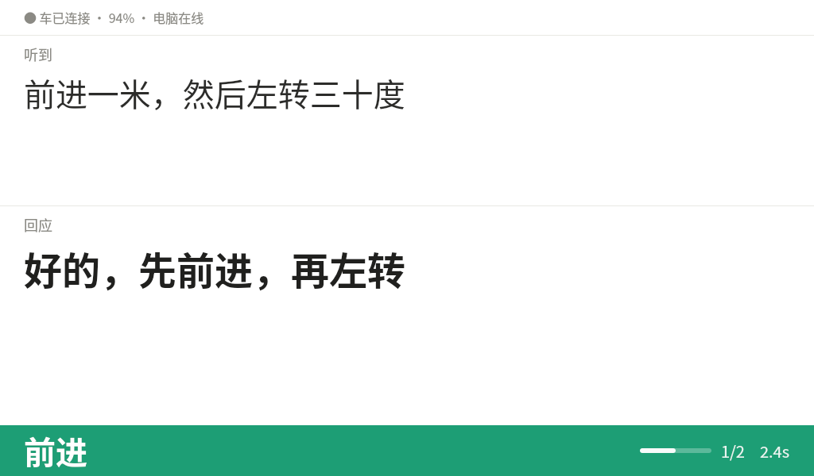
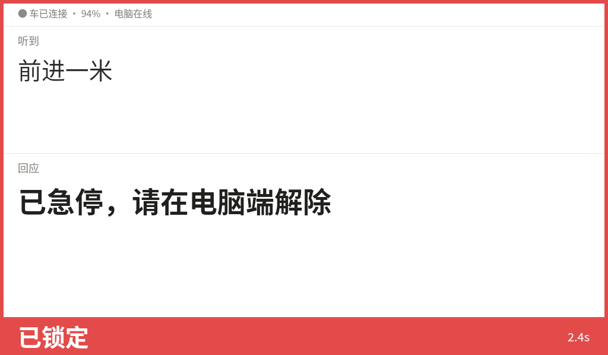
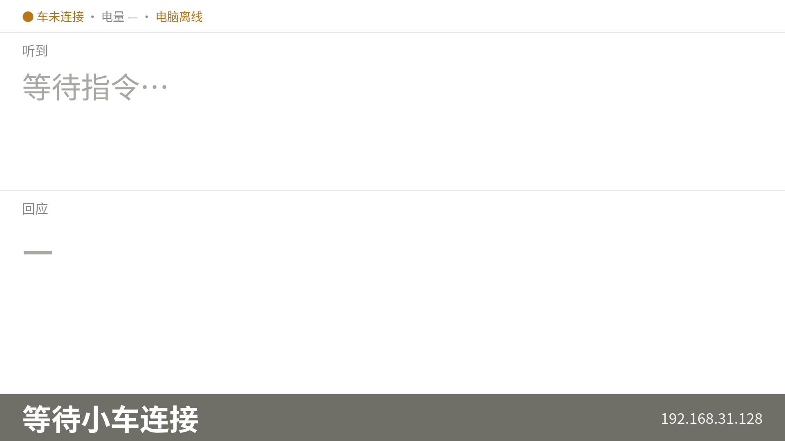

# 开发板展示屏方案（大字演示界面）

> 项目：大创 · 人机交互智能小车
> 平台：华为 Atlas 200I DK A2（昇腾 310B4）+ 官方 Ubuntu 22.04
> 显示硬件：**7 寸 HDMI 屏，1024×600，非触摸**，有效显示区约 15.5 cm × 10 cm
> 前置阅读：《[远程 Web 控制台](远程Web控制台.md)》《[控制台 UI 改版方案](控制台UI改版方案.md)》
> 状态：**P0 + P1 + P2 已实施；v3「减法版」定稿（71 项断言，2026-10-29）；
> v4「开机免登录自启 + 防息屏」真机验证通过（84 项断言 + 自启链路 58 条，2026-11-03）**

---

## 一、要解决什么

现在的分工是：**电脑端负责操作**（浏览器控制台），**小车负责动**。但现场少了一环——

> **观众看到的只有"车动了"，看不到"它听到了什么、又想说什么"。**

而这恰好是项目最值钱的部分（听 → 想 → 说 → 动）。所以要给板子接一块屏，
专门**面向观众**做实时展示：

| 要展示 | 为什么 |
|---|---|
| **刚听到的话** | 让观众知道"它真的听懂了"，而不是碰巧动了 |
| **对应的回应** | 展示 TTS + LLM 这条链路 |
| **当前移动状态** | 远距离第一眼要能看出"在前进还是左转" |
| 响应耗时 | 证明是端侧实时，不是录像 |

---

## 二、先算清楚物理约束（这决定一切）

### 2.1 像素与物理尺寸

1024×600 装进约 15.5×10 cm：

| 项目 | 数值 |
|---|---|
| 横向 | 1024 px / 15.5 cm ≈ **168 DPI** |
| 纵向 | 600 px / 10 cm ≈ 152 DPI |
| **取整** | **1 px ≈ 0.16 mm** |

> 两个方向算出来不一致，说明标称尺寸是估的。设计时按 **0.16 mm/px** 保守取值。

### 2.2 字号能看多远（人眼 0.5° 舒适 / 0.3° 勉强）

`可读距离 ≈ 字高 × 114`（舒适）、`× 191`（勉强）

| 字号 | 物理字高 | 舒适阅读 | 勉强可辨 |
|---|---|---|---|
| **72 px** | 11.5 mm | **1.3 m** | 2.2 m |
| **56 px** | 9.0 mm | **1.0 m** | 1.7 m |
| **44 px** | 7.0 mm | **0.8 m** | 1.3 m |
| 22 px | 3.5 mm | 0.4 m | 0.7 m |
| 18 px | 2.9 mm | 0.3 m | 0.6 m |

### 2.3 结论（必须先接受这个前提）

> **这块屏的最佳观看距离是 1 ~ 1.5 米，2 米外只剩状态大字能认，3 米外只能看到色块。**

物理限制，设计绕不过去。含义：

- ✅ **展台近距离演示**（观众走到跟前）—— 效果很好；
- ⚠️ **答辩坐在 3 米外** —— 只能当"氛围屏"，细节读不到；
- 要远距离看清，得换 15.6 寸 1080p 或上投影，不是改字号能解决的。

**所以本方案的一切取舍，都服从"1 米内极清晰"这个目标，不追求远距离。**

### 2.4 非触摸 → 纯展示

该屏**不带触摸**，因此：

- 不实现任何点击 / 滑动 / 长按；
- 不提供"解除急停"之类需要交互的入口；
- 所有操作仍在电脑端，大屏**只读**。

---

## 三、三个架构决策

### 3.1 大屏是「只读客户端」，不能自己起控制器

串口 `/dev/ttyCAR` 是**独占资源**。若大屏自己 `CarController()`，会和 `car_web.py` 抢串口，
两边都连不上。所以大屏**只通过 HTTP 读数据**，一行串口代码都不碰。

### 3.2 不用「控制台拉起 GUI」，改成「常驻 + 自动切态」

直觉做法是 `car_web` 收到浏览器请求时 `subprocess` 拉起 Qt。**不采用**：

| 问题 | 后果 |
|---|---|
| Qt 需要 X 会话 / `DISPLAY` | 以服务方式或被 SSH 拉起会直接失败 |
| 子进程崩溃无人管 | 演示中黑屏 |
| 重复拉起要加锁 | 双开两个全屏窗口互相打架 |

改为：**大屏进程常驻，平时显示待机页；检测到控制台在线 → 自动切演示态**。
体感一致（打开控制台，屏自己亮起来），但稳定得多。

### 3.3 直接复用已落地的 `/api/events`

该接口 **2026-10-28 已随控制台 P0+P1 实现**（环形缓冲 240 条，带 `turn` 聚合）。
大屏是它的**第一个非浏览器消费者**——不必再解析纯文本日志，也不会把内部术语漏给观众。

### 3.4 数据流

```
CarController（car_web.py 进程，独占串口 / 麦克风）
        │
        │ 结构化事件环形缓冲（200 条）
        ▼
  GET /api/status?role=display          1 Hz   状态/电量/动作/在线标记
  GET /api/events?since=N               1 Hz   听到/纠错/执行/回应
        │
        ├──► 电脑浏览器控制台（可操作）
        └──► 板子大屏 Qt 客户端（只读，全屏）
```

两边**读同一份数据**，所以永远一致，不需要额外同步逻辑。

---

## 四、界面设计

### 4.1 版式（600 px 精确分配）

| 区域 | 高度 | 内容 | 说明 |
|---|---|---|---|
| 状态条 | **44 px** | 连接点 · 电量 · AI 后端 · 控制台在线 | 18 px 字，一行放下 |
| **听到** | **140 px** | 标签 18 px + 文本 **44 px × 2 行** | 最长 2 行，超出截断 |
| **回应** | **150 px** | 标签 18 px + 文本 **56 px × 1 行**（必要时 2 行） | 视觉主角 |
| **移动状态** | **180 px** | 动作 **72 px** + 进度条 8 px + 步数 22 px | 远距离第一眼 |
| 耗时条 | **46 px** | `听到 → 回应 2.4 秒` | 22 px 灰字 |
| 留白 | **40 px** | — | 呼吸感 |
| **合计** | **600 px** | | |

```
┌──────────────────────────────────────────────────┐  44  状态条
│ ● 已连接 · 电量 78% · 云端 AI      控制台在线     │
├──────────────────────────────────────────────────┤
│ 听 到                                             │ 140
│ “钱进一米，然后左转三十度”          ← 44 px        │
├──────────────────────────────────────────────────┤
│ 回 应                                             │ 150
│ “好的，先前进，再左转”              ← 56 px        │
├──────────────────────────────────────────────────┤
│  前进  ████████░░░░░░  第 1/2 步    ← 72 px       │ 180
├──────────────────────────────────────────────────┤
│ 听到 → 回应 2.4 秒                                │  46
└──────────────────────────────────────────────────┘  40 留白
```

**为什么"回应"比"听到"大**：观众更关心"车说了什么"；且 LLM 回复有 `SAY_MAX_CHARS=12`
限制，56 px 一行约 17 字，**一行放得下**。听到是 ASR 原文、可能更长，所以给 2 行。

### 4.2 内容容量（决定截断策略）

| 字号 | 一行约 | 分配 | 上限 |
|---|---|---|---|
| 44 px | 22 字 | 2 行 | 44 字 |
| 56 px | 17 字 | 1 行 | 17 字（实际 ≤12） |
| 72 px | 13 字 | 1 行 | 13 字 |

**规则**：超出就**截断加省略号**，绝不缩字号。
缩到 24 px 就失去了"大字屏"的意义——宁可少显示几个字。

### 4.3 状态语义与配色

白底深字（展厅亮环境对比度最高），状态色**只出现在状态区**：

| 状态 | 显示 | 颜色 |
|---|---|---|
| 前进 | `前进` + ▲ | 绿 `#1D9E75` |
| 后退 | `后退` + ▼ | 蓝 `#185FA5` |
| 左转 / 右转 | `左转` / `右转` | 琥珀 `#BA7517` |
| 停止 / 待机 | `停止` | 灰 `#888780` |
| **急停锁定** | `已急停` | 红 `#E24B4A` + **整屏 6 px 红边** |
| 与主控断开 | `未连接` | 灰底 + 重连提示 |

> 深色主题留一个配置开关（展厅暗光时切），默认白底。

### 4.4 四种场景态

| 态 | 触发 | 显示 |
|---|---|---|
| **演示态** | 控制台在线 | 正常显示对话 + 状态 |
| **待机态** | 无控制台 60 s | 中央 `等待控制台连接`；保留最后一条对话但**变灰降级** |
| **急停态** | `estop_locked` | 整屏红边 + 中央 `已急停 · 请在电脑端解除`，**无按钮** |
| **断连态** | HTTP 连续失败 | 灰底 + `与主控断开 · 重连中`，2 s 重试，进程不退出 |

### 4.5 响应耗时

拆两个指标，不要混成一个：

| 指标 | 定义 | 预期 |
|---|---|---|
| **识别** | 用户说完 → ASR 文本上屏 | 1.0~1.5 s（含 VAD 断句 0.8 s） |
| **响应** | ASR 文本 → 动作下发 / TTS 开始 | 0.5~4.5 s（规则命中快、云端 LLM 慢） |

显示：`听到 → 回应 2.4 秒`（总耗时）。需要时可展开为 `识别 1.1 · 响应 1.3`。

数据来源：直接取 `/api/events` 里两条事件的 `ts` 差值，**后端不必额外加字段**。

---

## 五、联动机制

### 5.1 时序

```
T0         电脑打开 http://板子:8090/
T0         car_web 记下该客户端心跳
T0 + ≤1s   大屏读到 console_online=true → 淡出待机页，切演示态
...
T0+X       电脑关页面 / 断网
T0+X+3s    心跳超时 → console_online=false
T0+X+60s   大屏回待机态（保留最后一条对话，变灰）
```

**为什么回待机要等 60 秒**：演示中途刷新页面、切 Wi-Fi 都会短暂断连，
30 秒内闪回待机很难看。

### 5.2 ⚠️ 必踩的坑：大屏自己会把"在线"顶成 true

`/api/status` 本来就是控制台每秒调的。如果 `console_online` 按"有没有请求"算，
**大屏自己的轮询也会续期**——于是永远在线，待机态形同虚设。

→ 解法：大屏请求带 **`?role=display`**，`car_web` **只统计非 display 的请求**；
或给大屏单开 `/api/display/state`。

### 5.3 客户端识别

`car_web` 维护 `last_browser_seen` 时间戳：任何非 `role=display` 的 `/api/status` 请求都更新它。
`console_online = (now - last_browser_seen) < 3.0`。

---

## 六、后端改动（`car_web.py`）

### 6.1 已经具备（2026-10-28 随控制台 P0+P1 落地，可直接用）

| 能力 | 接口 / 字段 | 说明 |
|---|---|---|
| 结构化事件流 | `GET /api/events?since=N` | 环形缓冲 **240** 条，带 `seq` / `ts` / `type` / `turn` |
| 多步进度 | `status.plan_step / plan_total / plan_label` | 直接可用 |
| 最近识别文本 | `status.asr_text` / `asr_cost` | 有 |
| 动作与速度 | `status.action_label` / `speed_mmps` | 有 |
| 急停 | `status.estop_locked` / `estop_reason` | 有 |
| 电量 | `status.voltage` / `volt_level` | 有 |

**事件类型（按真实实现，不是设想）**

| type | 含义 | 关键字段 |
|---|---|---|
| `heard` | 听到（ASR 原文） | `text` / `src` |
| `reply` | 回应（闲聊 / 播报文本） | `text` / `pending` |
| `exec` | 动作已下发 | `label` / `demo` |
| `reject` | 被拒绝（锁定 / 未连接 / 没听清） | `reason` |
| `step` | 多步进度 | `step` / `total` / `label` |
| `plan_done` | 多步结束 | — |
| `estop` / `release` | 急停 / 解除 | `reason` |

> 每条事件都带 **`turn`**（一次用户输入 = 一个 turn）。
> **大屏按 `turn` 聚合「听到 + 回应」即可**，不用自己猜配对——这是现成的便利。

### 6.2 仍需新增（只有两项）

| 改动 | 说明 |
|---|---|
| `status` 增加 `console_online` | 最近 3 s 内有**非 display** 客户端请求 |
| 支持 `?role=display` | 大屏请求带此参数，不计入 `console_online`（见 §5.2） |

> `reply_text` **不必新增**：从 `/api/events` 取最近一条 `reply` 事件的 `text` 即可。
> 耗时也**不必新增字段**：`heard.ts` 与 `reply.ts`（或 `exec.ts`）相减即可。

---

## 七、稳定性设计

| 风险 | 对策 |
|---|---|
| 连不上主控 | 显示断连态，2 s 重试，**进程不退出** |
| 主控重启导致 `seq` 跳变 | 检测 `seq` 回退 → 重置游标，全量拉最近 20 条 |
| 大屏进程崩溃 | systemd `Restart=always` + `RestartSec=2`（或 xinit 循环拉起） |
| 屏幕自动黑屏 | `xset s off -dpms`——**演示翻车最常见原因**，必须写进启动脚本 |
| 内存增长 | 只保留最近 2 条对话 + 200 条事件 |
| 主控还没起来 | 先显示待机页，不报错 |
| 网络抖动 | 本地回环/局域网，忽略；连续 5 次失败才切断连态，避免闪 |

---

## 八、部署与运行

### 8.1 启动方式（不加载桌面）

```bash
# run_display.sh
#!/bin/bash
xset s off -dpms
xset s noblank
export QT_ENABLE_HIGHDPI_SCALING=0
exec /usr/bin/python3 /home/HwHiAiUser/car_gui/display.py
```

```bash
xinit /home/HwHiAiUser/car_gui/run_display.sh -- :0
```

**为什么不用桌面**：自动登录桌面再起 Qt 会多占 200 MB 左右内存，
而 4 GB 板子还要同时跑 ASR（228 MB 模型）+ TTS（NPU）+ 可选 LLM。

### 8.2 四个必踩的坑

| 坑 | 现象 | 对策 |
|---|---|---|
| **DPI 缩放** | 56 px 被放大 1.75 倍，版式崩 | `QT_ENABLE_HIGHDPI_SCALING=0`，且**只用 `setPixelSize()`，不用 `setPointSize()`** |
| **中文字体缺失** | 一屏方块（豆腐块） | 显式指定 `Noto Sans CJK SC`，启动时检测字体是否存在，缺失则回退并提示 |
| **屏保 / DPMS** | 演示中途黑屏 | `xset s off -dpms`（写进启动脚本） |
| **HDMI 口选错** | 无信号 | 用 **HDMI0**（HDMI1 为预留口） |

### 8.3 与现有 GUI 的关系（互斥）

| 场景 | 启动方式 | 板上界面 |
|---|---|---|
| **演示** | `run_display.sh`（xinit + 大屏） | 只有大屏，**不启动 PySide6 主 GUI** |
| 调试 | `run_gui.sh` | 完整 PySide6 操作界面 |

两者都属于全屏程序，**不要同时跑**。演示时板上不需要键鼠。

### 8.4 内存预算（估算）

| 进程 | 占用 |
|---|---|
| `car_web.py`（控制器 + ASR + TTS） | ~1.2~1.6 GB |
| **大屏 Qt（本方案）** | **~100~150 MB** |
| PySide6 主 GUI（演示时不启动） | 省下 ~200 MB |

> 演示模式比"开主 GUI"更省内存——这是"不开 PySide6"带来的额外好处。

---

## 九、分期

| 期 | 内容 | 工作量 | 验收 |
|---|---|---|---|
| **P0** | 大屏 + 待机/演示切换 + `status` 轮询（动作 / 电量 / 急停） | 0.5 天 | 1 米外读清回应 |
| **P1** | 接 `/api/events`：听到 / 回应 + `turn` 聚合 + 耗时 | 0.5~1 天 | 耗时误差 <0.2 s |
| **P2** | 多步 k/n + 急停红边 + 断连态 + 字体兜底检测 | 0.5 天 | 拔网线不崩、恢复自动继续 |

---

## 十、验收标准

- [ ] **1 米外**能读清"回应"整句；**1.5 米外**能读清"前进/左转"
- [ ] 控制台打开后 **≤1 s** 切到演示态
- [ ] 控制台关闭 **60 s** 后回待机态（中途刷新页面不闪）
- [ ] 急停时红边 **≤200 ms** 出现
- [ ] 拔网线 → 显示断连、进程不退出；插回 → 自动恢复
- [ ] 连续运行 8 小时，内存无增长（RSS 波动 <20 MB）
- [ ] 屏幕上**点任何位置都没有反应**（非触摸屏 + 不绑事件）
- [ ] 无中文字体时不会出现方块（有兜底提示）

---

## 十一、明确不做

| 不做 | 原因 |
|---|---|
| 触摸 / 点击交互 | 屏幕非触摸；纯展示 |
| 在大屏上解除急停 | 操作全部留在电脑端，责任边界清楚 |
| 加载桌面环境 | 省 200 MB 内存 |
| 视频 / 花哨动画 | 抢 CPU，影响 ASR/TTS |
| 显示原始日志 | 观众不需要，且会漏内部术语 |
| 多语言 | 中文单语场景 |

---

## 十二、实施记录（2026-10-28）

### 12.1 落地文件

| 文件 | 作用 |
|---|---|
| `car_gui/display.py` | 展示屏本体（只读 Qt 客户端，纯 HTTP，不碰串口） |
| `car_gui/run_display.sh` | 启动器：选解释器、关 DPI 缩放、`xset s off -dpms`、中文字体检查 |
| `car_gui/setup_display_autostart.sh` | 开机自启：`--desktop`（登录桌面自启，推荐）/ `--xinit`（systemd + 独立 X）/ `--status` / `--uninstall` |
| `car_gui/test_display.py` | 43 项离屏断言（版式/缩放/截断/四态/配色/Turn 聚合） |
| `car_web.py` | 新增 `console_online` / `console_age`，支持 `?role=display` |

### 12.2 与方案的三处差异（都是为了更稳，实施时改的）

| 方案原文 | 实际做法 | 为什么 |
|---|---|---|
| 按 1024×600 固定版式 | **按屏幕实际分辨率等比缩放**（`k = 屏高/600`，可 `--scale` 覆盖） | 板子没接显示器时内核会报 1920×1080 之类的默认值，写死会错位；用户也可能临时接 1440p 显示器看效果 |
| 大屏自己 `xinit`、不加载桌面 | **默认走桌面自启**（`.desktop`），`--xinit` 作为进阶选项保留 | 板子默认进 LXQt + sddm；冒然改启动目标会和 sddm 抢 VT/显示，现场翻车成本高 |
| 电量显示"78%"（未说来源） | 用 4S 电池曲线把 `status.voltage` 换算成百分比 | 实施时踩到过：直接把**伏特**当百分比打印，满电 15.9 V 显示成"电量 15%"，像快没电 |

### 12.3 关键实现细节（改代码前必读）

1. **请求必须带 `?role=display`**：`car_web` 只把**非 display** 的 `/api/status`
   计入 `console_online`。大屏自己每秒轮询，不带这个参数就会永远把"控制台在线"
   顶成 true，待机态形同虚设（方案 §5.2 的坑，已写进 `test_web_console.py` 断言）。
2. **只用 `setPixelSize()`**，并且 `run_display.sh` 里导出
   `QT_ENABLE_HIGHDPI_SCALING=0 / QT_AUTO_SCREEN_SCALE_FACTOR=0 / QT_SCALE_FACTOR=1`。
3. **中文字体三级探测**：`QFontDatabase.writingSystems`（Qt5 有、Qt6 已移除）→
   `hasFamily` 按名字查 → 任何支持中文的字体。都不行才提示装 `fonts-noto-cjk`。
   ⚠️ Linux 的 `offscreen` 平台**能**拿到系统字体，Windows 的 offscreen 不能 ——
   所以"在电脑上离屏预览"看到方块是正常的，别当 bug。
4. **超长截断**：用 `QFontMetrics` 按**实际像素宽**算每行字数，再加省略号；
   绝不为了塞下而缩字号。
5. **Turn 聚合**：`heard` / `reply` / `exec` / `reject` 都带 `turn`，按它配对，
   不自己猜；只保留最近 6 轮，防内存增长。
6. **四种态**：演示（`console_online`）/ 待机（离线 >60 s，中途刷新不闪）/
   急停（整屏 6 px 红边 + 中央解除提示）/ 断连（连续 5 次失败，2 s 重试）。
7. **退出干净**：`test_web_console.py` 末尾用 `os._exit()` 跳过解释器收尾 ——
   守护线程在 finalize 时写 stdout 会触发 `_enter_buffered_busy`，
   断言全过却返回退出码 1，`test_all_offline.py` 会误判失败。

### 12.4 怎么跑

```bash
# 板子接上显示器后（本地终端或 VNC 里）
bash ~/car_gui/run_display.sh                     # 全屏演示

# 不需要显示器，先看版式（会存一张 PNG）
bash ~/car_gui/run_display.sh --screenshot /tmp/display.png
bash ~/car_gui/run_display.sh --screenshot /tmp/d.png --size 2560x1440   # 按你的显示器尺寸预览
bash ~/car_gui/run_display.sh --theme dark        # 暗环境

# 开机自启
bash ~/car_gui/setup_display_autostart.sh             # 登录桌面后自动全屏（推荐）
bash ~/car_gui/setup_display_autostart.sh --status    # 看状态
```

### 12.5 效果图

| 1024×600（目标屏） | 2560×1440（等比放大） |
|---|---|
|  |  |

> 这两张是**离屏渲染**（`--screenshot`），版式与真机一致；
> 真机照片请以现场拍摄为准（镜头畸变会让人误判字号）。

### 12.6 遗留

- **真机验证待做**：接上 7 寸屏后按 §十 验收标准逐条过（1 米读清回应、
  拔网线不崩、急停红边 ≤200 ms、8 小时无内存增长等）。
- 屏幕尺寸目前只能靠 `primaryScreen()` 实测；如果 HDMI 热插拔后窗口没跟着变，
  重启一次展示屏进程即可（Qt 全屏窗口不监听显示器变化）。

---
## 十三、v2 返工记录（2026-10-29，按真机照片反馈）

v1 接上屏后拍回来的照片暴露的真问题：**状态区还只是"排版"，不是"仪表"**。

| # | 真机问题 | v2 做法 |
|---|---|---|
| 1 | 停止时留一条满宽空进度条 + 一个孤立方块，像渲染 bug | 进度条**只在 `plan_running` 时出现**，平时整条 `hide()`；方块是"停止"的 ■ 箭头，v2 **停止状态不再画箭头** |
| 2 | "停止"和"回应"同一套黑字，远看分不清对话还是状态 | 状态区改成**满宽彩色横幅**（104 px，白字）：深灰停止 / 绿前进 / 蓝后退 / 琥珀转向 / 红急停。**远距离看色块不看字** |
| 3 | 「车：未连接」和「电脑：在线」并排成一句，读着自相矛盾 | 拆成**两颗带主语的芯片**：「车：已连接/未连接」+「电脑：在线/离线」——串口与网页是两个维度 |
| 4 | 听到/回应之间只有一条看不见的分隔线 | 两段左侧各加 **4 px 彩色竖条**：听到=蓝 `#185FA5`，回应=紫 `#534AB7` |
| 5 | 听到 44 px 比回应 56 px 小一号，权重失衡 | 听到提到 **48 px**（56:48 ≈ 1.17:1） |
| 6 | 屏幕写"米/秒"、播报说"毫米每秒"，两套单位 | 统一 **`中速 · 1.2 m/s`**（定性词取档位，数值取实测） |
| 7 | 顶部没有"成品感" | 顶部加 **4 px 状态色条**，颜色跟横幅联动 |
| 8 | 「响应 4.2 秒」加分项躲在角落 | 做成回应行右侧的**小徽标**「响应 4.2s」 |

**顺带**：版式从 `44/140/150/180/46` 调整为 `4/44/170/170/104/48`（合计 540，
余 60 留白），把原来浪费在空进度条上的 180 px 还给了「听到/回应」。

### 13.1 新增能力：四态出图

```bash
# 给文档/评审出图，无需显示器（--preview-state 支持 5 种状态）
bash run_display.sh --screenshot /tmp/plan.png   --preview-state plan
bash run_display.sh --screenshot /tmp/stop.png   --preview-state stop
bash run_display.sh --screenshot /tmp/estop.png  --preview-state estop
bash run_display.sh --screenshot /tmp/sb.png     --preview-state standby
bash run_display.sh --screenshot /tmp/dc.png     --preview-state disconnect
```

### 13.2 四态效果图

| 多步执行中（绿） | 停止（深灰，无进度条） |
|---|---|
|  |  |

| 急停（红横幅 + 整屏红边） | 待机 / 断连（灰） |
|---|---|
|  |  |

### 13.3 一条**代码解决不了**的建议

真机照片顶部有一条明显的**反光带**（室内灯在光面屏上的镜像），评委可能看不清
上半屏。三选一，按性价比排：

1. **调俯仰角** —— 让屏幕法线偏离灯位，成本 0；
2. **贴雾面/防眩光膜** —— 30 元级，效果最直接（7 寸屏专用膜很多）；
3. **切暗色主题**（`--theme dark`）—— 反光对比度会降低，但暗环境更舒服。

> 代码侧能做的只有"别用纯白底"（v2 已从 `#FFFFFF` 保留白底但避免大面积高亮块），
> 反光是**光学问题**，改字号/配色都治不好。

---
## 十四、v3 减法版（2026-10-29，第二轮真机反馈）

v2 的教训：**设计靠做减法，堆容器解决不了问题。**
v2 一屏里有 5 种容器互相抢戏（左侧竖条 / 顶部四颗胶囊 / 满宽色块横幅 /
进度条 / 整屏边框），结果**第一眼落在色块上，而不是内容上**。

### 14.1 版式：回到三层，靠字号分层

```
┌──────────────────────────────────────────────────┐
│ ● 车已连接 · 94% · 电脑在线                       │ 44  一行 16px 灰字
├──────────────────────────────────────────────────┤
│ 听到                                              │
│ 前进一米，然后左转三十度            ← 40px 常规    │ 214
├──────────────────────────────────────────────────┤
│ 回应                                              │
│ 好的，先前进，再左转                ← 48px 中黑    │ 弹性（吃满）
├──────────────────────────────────────────────────┤
│ 前进                          1/2 ▓▓░░   2.4s    │ 64  状态带
└──────────────────────────────────────────────────┘
```

字号序列 **16 / 18 / 40 / 48 / 40 / 20**，回应:听到 = **1.2:1**（不是 1.4）。

### 14.2 删掉的东西（这轮的主体）

| 删什么 | 为什么 |
|---|---|
| 两条 4 px 彩色竖条 | 贯穿整段只增加重量、不增加信息；字号区分就够了 |
| 顶部 4 颗胶囊 | 正常状态**一行灰字**即可，只有异常才上色 |
| 满宽 104 px 色块横幅 | 改成底部 **64 px 状态带**，不占满屏、不把界面切断 |
| 「响应 4.2s」独立胶囊 | 并进状态带右侧，只留一个数 `2.4s` |
| 「第 1/2 步」独立行 | 并进状态带（`1/2` + 迷你进度条） |
| 大三角箭头 | 删 ——「前进」两个字已经说清了 |
| 顶部 4 px 装饰色条 | 删（纯装饰） |
| 紫色/蓝色装饰色 | 颜色只留语义：**绿=运动、红=急停、黄=未连接/降级**，其余灰阶 |

### 14.3 状态语义重做

| 状态 | 状态带 | 右侧 | 其他 |
|---|---|---|---|
| 前进/后退/左转/右转 | **绿底** + 白字动作 | 速度 + 耗时 | — |
| 停止 | **灰底** + 白字「停止」 | **只显示耗时**（停了不报速度） | 进度条隐藏 |
| 多步计划 | 绿底 + 白字动作 | `1/2` + 迷你进度条 + 耗时 | 全部在带内 |
| 急停 | **红底** + 白字「已锁定」 | 耗时 | 回应区**常规色**写「已急停，请在电脑端解除」；**整屏 6 px 红边** |
| 待机 | 灰底「等待控制台连接」 | 板子 IP | 对话变灰降级 |
| 断连 | 灰底「与主控断开」 | 重连中 | 顶部那行变黄 |

**红只出现两处**（状态带 + 边框），不再"红字 + 红块 + 红边"三重过载；
「已急停」只出现一次（在回应区），状态带改说「已锁定」避免重复。

### 14.4 深色主题单独调（不是只换底色）

- 分隔线 → `rgba(255,255,255,0.12)`（纯色线在深底上会消失，层次全塌）
- 绿色 → `#1E7A5C`（亮绿在深底上刺眼；白字仍然压得住）
- 顶部同步成同一行灰字

### 14.5 顺带修掉一个**真 bug**：急停红边画不出来

`setStyleSheet("background:#FFF")` 的样式会**级联到子控件**，子块把父窗口
整片区域重新刷白 → `paintEvent` 里画的边框被盖掉，**"状态变了但看不到红边"**。
改成**置顶透明边框 QFrame**（最后一个子控件 + `raise_()`），并且状态变化时
主动 `update()`（全屏窗口平时没有别的重绘来源）。

> 这个 bug 是 v3 的测试抓出来的：断言"整屏红边 → 左上角像素偏红"失败才发现。
> v2 那条断言当时"通过"是因为顶部 4 px 色条恰好是红色，**测到的是别的东西** ——
> 教训：像素断言要连着看多个采样点。

### 14.6 验证

- 板上整套回归：**通过 12 · 失败 0 · 跳过 1**
- 展示屏：**71/71**（新增：只有四块、字号序列、无竖条/胶囊/装饰条、
  顶部只有异常才黄、停止不报速度、红只出现两处、急停用置顶帧画边框、
  深色分隔线与绿色单独调）

### 14.7 一条判断标准（留给后续改动）

> **1 米外眯眼看，第一眼落在哪？**
> 应该先落在「好的，先前进，再左转」和「前进」上。
> 如果先看到的是色块、边框、图标 —— 说明又堆容器了。

---
## 十五、v4 开机免登录就有画面（2026-11-03 真机验证）

### 15.1 需求原话

> 「只要电脑这边连上开发板的时候（不用管小车是否已经连接上），开发板不论是否输密码登录进了桌面，都能同步显示 gui 展示界面」

拆成三条硬要求：

| 要求 | 含义 | 实现 |
|---|---|---|
| **免密码登录** | 板上不论有没有人输密码，开机都要有画面 | sddm 自动登录 LXQt（`/etc/sddm.conf.d/50-car-autologin.conf`），约开机后 **15 s** 出桌面，再由用户级 autostart 拉展示屏 |
| **不等小车** | 小车没上电、串口没连，也要先把屏画出来 | 展示屏只读 HTTP；车未连接时状态带显示「等待小车连接」+ 板子 IP，**不报速度**、不退出 |
| **电脑连上就能看** | 电脑打开控制台 → 屏自动切演示态 | 沿用 v3 联动（`console_online`，≤1 s 切态，见 §五） |

### 15.2 完整链路

```
开机
 └─ sddm 读 /etc/sddm.conf.d/50-car-autologin.conf
      [Autologin]
      User=HwHiAiUser
      Session=lxqt
      Relogin=true
    → 免密码自动登录（约开机后 15 s 进 LXQt 桌面）
 └─ LXQt 会话读 ~/.config/autostart/car-display.desktop
    → 执行 display_supervisor.sh --delay=3
 └─ display_supervisor.sh（看护进程，~/.cache/car-display.log）
    ├─ flock 单实例 —— 防两块界面抢屏
    ├─ 等主控 /api/status 最长 20 s —— 避免开屏闪「与主控断开」
    ├─ 拉起全屏 display.py（只读、不碰串口、始终带 ?role=display）
    └─ display.py 退出后按退出码决定：
         0 = 用户按 Esc 主动退出 → 不再拉起
         3 = 没有 DISPLAY → 不空转
         其它 = 崩溃 → 2 s × 次数退避重启；连续 6 次失败改 120 s 慢速重试
```

`display_supervisor.sh` 参数 `--delay=N` / `--wait-web=N`；环境变量 `CAR_DISPLAY_*` 可覆盖（测试用）。

> **屏上「电脑在线 / 电脑离线」到底看什么？** 看的是**电脑端浏览器控制台页面**最近 3 秒有没有在轮询 `/api/status`（大屏自己带 `?role=display` 轮询，**不**算）。
> 所以：只开着 SSH、只 ping 得通，屏上仍然是「电脑离线」——这是对的；在电脑浏览器里打开 `http://<板子IP>:8090/`，1~3 秒内就会变「电脑在线」。
> 板子 IP 就写在状态带右侧（如 `192.168.31.128`）。

### 15.3 四种装法对比

| 装法 | 要不要登桌面 | 内存 | 适用场景 | 一条命令 |
|---|---|---|---|---|
| **`--boot`（推荐）** | 是，但**自动登录、不输密码** | 桌面比 kiosk 多占 200~300 MB | 要能按 Esc 回桌面改设置、看日志 | `sudo bash ~/car_gui/setup_display_autostart.sh --boot` |
| **`--boot-kiosk`** | 否，只跑展示屏会话 | **省 200~300 MB** | 演示专用、装上就不动 | `sudo bash ~/car_gui/setup_display_autostart.sh --boot-kiosk` |
| **`--desktop`（默认）** | 是，但要**人输密码**登录 | 同 `--boot` | 宿舍调试、不想动登录配置 | `sudo bash ~/car_gui/setup_display_autostart.sh --desktop` |
| **`--xinit`** | 否，独立 X（老办法） | 不加载桌面，省桌面内存 | sddm 出问题时的兜底；**与 autologin 二选一** | `sudo bash ~/car_gui/setup_display_autostart.sh --xinit` |

维护开关：`--status`（看现在装了什么）、`--print-config`（只打印将写入的配置，不改系统）、`--apply`（改完立刻重启 sddm 生效）、`--no-autologin`（恢复输密码登录）、`--uninstall`（整套卸掉）。

### 15.4 Esc、桌面图标与日志

| 操作 | 结果 |
|---|---|
| 屏上按 **Esc**（或 F12） | 展示屏退出（退出码 0）→ 看护进程**不再拉起** → 回 LXQt 桌面 |
| 点桌面图标 `~/桌面/小车展示屏.desktop` | 随时全屏重开，不用敲命令（kiosk 模式没有桌面，所以也没有这个图标） |
| 崩了先看什么 | `~/.cache/car-display.log`；日志 **>1 MB 自动截断**，不会撑爆 SD 卡 |

### 15.5 冷启动的两个修正（`display.py`）

| 问题 | 修正 | 为什么 |
|---|---|---|
| 开机把**上一次演示**的「前进一米 / 好的」当成这次的话推到屏上 | Fetcher 首帧只推游标、不回放历史（`_prime()`） | 展示屏每次开机都是"新听众"，不能继承上一场对话 |
| 真机上抓到过「车未连接 + 绿色前进 0.3 m/s」自相矛盾 | 车未连接时状态带改**灰色「等待小车连接」+ 板子 IP**，不报速度 | 没连车就不该有速度；两种信息打架，观众第一眼就不信 |

### 15.6 回滚三板斧

| 想干什么 | 命令 | 说明 |
|---|---|---|
| 恢复输密码登录 | `sudo bash ~/car_gui/setup_display_autostart.sh --no-autologin` | 撤掉 sddm 自动登录；要连桌面自启项一起卸，用 `--uninstall` |
| 整套卸掉（自启 + 自动登录） | `sudo bash ~/car_gui/setup_display_autostart.sh --uninstall` | 回到「手动跑 run_display.sh」的状态 |
| 登录界面 / 显示卡住 | `sudo systemctl restart sddm` | 重启显示管理器；会退出当前桌面，**从 SSH 里执行最稳** |

### 15.7 踩过的坑

| 坑 | 现象 | 怎么办 |
|---|---|---|
| **没接显示器时分辨率是内核默认的 1920×1080** | `xrandr` 报 1920×1080，不是 7 寸屏的 1024×600 | 展示屏本来就按实际分辨率等比缩放（§12.2），不会拉花；接上真屏后自然变成真实分辨率 |
| **autologin 后板上等于没有密码** | 谁摸到板子都能进桌面、看文件 | 安全边界靠 **SSH**（密码/密钥）与物理位置；演示结束用 `--no-autologin` 恢复 |
| **kiosk 模式没有桌面** | 按了 Esc 之后是空会话，无处可回 | 要能回桌面改东西就用 `--boot`；`--boot-kiosk` 只适合「装上就不动」 |
| **`--apply` 会注销当前桌面** | 在板子桌面里跑，屏幕闪一下回登录/新会话 | 从 SSH 里执行，别在正在演示的桌面里跑 |
| **开机时钟被 RTC 带偏 8 小时** | 板上 `date` 比电脑快 8 h；`console_age` 变负数，「电脑在线」卡住几小时不掉（心跳落在"未来"） | 板子 RTC 里存的是本地时间却被当成 UTC 读。修：`sudo timedatectl set-local-rtc 0` → `sudo hwclock --systohc --utc` → `sudo timedatectl set-ntp true`（2026-11-03 已在板上修好）。`car_web.py` 另加了 `0 ≤ age < 3` 下界判断，时钟再被拨也不会假在线 |

### 15.8 真机验证记录（2026-11-03 21:0x）

| 检查 | 结果 |
|---|---|
| 自动登录 | `loginctl` 出现 `HwHiAiUser seat0`；Xorg + lxqt-session 起来 |
| 展示屏进程 | `display_supervisor.sh` 与 `display.py` 都在跑 |
| 分辨率 | `xrandr` 1920×1080（未接显示器时内核报的默认模式） |
| 确实画出来了 | 用 `QScreen.grabWindow(0)` 抓到整屏 PNG，状态带是「等待小车连接」（当时小车未上电） |
| 真重启后 | 开机后**无人登录**，`loginctl` 直接出现 `HwHiAiUser seat0`，屏上就是展示界面；时钟 `21:16 CST`（RTC 已改成存 UTC） |
| 崩溃自愈 | `kill` 掉 `display.py` 后 **2 s 自动重启**；日志 `退出码 143（跑了 115s），2s 后重启` |
| 回归 | 展示屏 **84 条**；开机自启链路 **58 条**（Windows 侧 45 条静态）；整套离线回归 **13 套** |

| 真机整屏（1920×1080 抓屏） |
|---|
|  |

> 资产路径：`6.说明文档/7.参考资料/展示屏/展示屏-开机自启-等待小车连接.png`。
> 状态带显示「等待小车连接」是因为**小车未上电**；右侧是板子 IP，电脑端照这个地址打开控制台即可。

### 15.9 判断标准不变

> **1 米外眯眼看，第一眼落在哪？**
> 开机后的待机画面同样适用：应该先看到「等待小车连接」和板子 IP，
> 而不是先看到桌面壁纸、色块、边框。从"开机"到"有画面"这一段，也属于展示体验。

### 15.10 防息屏：长期不动不能黑屏（2026-11-03 追加，用户实测反馈）

**现象**：展示屏画面本来就不怎么变，放着十几分钟后**屏黑了**；在电脑端下指令，
屏也不亮 —— 只能过去按键盘/动鼠标才醒。

**为什么会这样（实测查到的）**：板子的镜像里同时装了**三套**省电/屏保：
`lxqt-powermanagement` + `xfce4-power-manager` + `xscreensaver`，开机**全都会自启**，
各管各的，空闲几分钟就把 X 的 DPMS 关屏打开（`Standby/Suspend/Off = 600`）。
而 `run_display.sh` 里的 `xset -dpms` 只是**一次性设置**，它们启动/改配置时又会打开。
更关键的是：**电脑端发指令走 HTTP，不是 X 输入事件**，X 的"空闲计时"永远不归零，
屏保根本不会自己退 —— 所以"下指令看不见反应"，其实屏是黑的。

**修法（两道保险）**：

| 层 | 做法 | 位置 |
|---|---|---|
| 根源 | 装自启时在 `~/.config/autostart/` 用**同名 `Hidden=true`** 挡掉五个守护进程（`lxqt-powermanagement`、`lxqt-xscreensaver-autostart`、`xscreensaver`、`xfce4-power-manager`、`xfce4-screensaver`） | `setup_display_autostart.sh --boot / --desktop` 自动装 |
| 兜底 | display.py **每 20 s** 重申一次：点亮 → 空闲超时清零 → 关屏保 → 禁 DPMS；**收到新指令/新事件立刻再重申**（≤2 s） | `display.py` `_keep_awake()` / `_wake()` |

**⚠️ 顺序有坑（实测）**：`xset dpms force on` **会把 DPMS 重新打开**。如果写成
"先 `-dpms` 再 `force on`"，最后留下的是 `Enabled + 600 s` —— 又变 10 分钟黑屏。
正确顺序是：

```bash
xset dpms force on      # 1) 先点亮（会把 DPMS 打开）
xset dpms 0 0 0         # 2) 空闲超时清零：0 = 永不黑屏
xset s off -dpms        # 3) 关屏保，最后再禁掉 DPMS
```

**真机验证（2026-11-03）**：

| 测试 | 结果 |
|---|---|
| `xset dpms force off` 模拟黑屏，不动键盘 | **+18 s 自己亮了**（20 s 周期任务） |
| 黑屏状态下，电脑端 `POST /api/text` 发一句指令 | **1.3 s 屏就亮了**（新事件触发 `_wake()`） |
| 手动把 DPMS 改回 `20/20/25`（模拟守护进程又打开） | 25 s 内被清零成 `0/0/0`，且 `DPMS is Disabled` |
| 重启后检查 `:0` 会话的守护进程 | `xscreensaver` / `lxqt-powermanagement` / `xfce4-power-manager` **一个都没起来**（板上另有镜像自带的 root `xfce4-session` 跑在 `:1`，不碰 `:0` 这块屏，与本方案无关） |

**还黑屏了怎么查**：

```bash
# ① 是不是旧会话残留的守护进程（改配置前登录的会话不会自动退出）
pgrep -af 'xscreensaver|xfce4-power-manager|lxqt-powermanagement'
#   有就杀掉，或直接重启板子；② 看 DPMS 超时是否被谁改回去了
DISPLAY=:0 XAUTHORITY=~/.Xauthority xset q | sed -n '/DPMS/,$p'
```

---

## 附：一页速记

```
硬件：7 寸 1024×600 非触摸，1px≈0.16mm，最佳观看 1~1.5 米
定位：只读展示客户端（串口独占，绝不能自己起 CarController）
联动：常驻 + 轮询 console_online；大屏请求必须带 ?role=display
版式：44 / 140 / 150 / 180 / 46 / 40 = 600
字号：回应 56 / 听到 44 / 动作 72 / 标签 18
超长：截断加省略号，绝不缩字号
耗时：识别 + 响应两个指标，显示总耗时
坑：DPI 缩放、中文字体、屏保黑屏、HDMI0
启动：xinit + QT_ENABLE_HIGHDPI_SCALING=0 + xset s off -dpms
自启：sudo bash ~/car_gui/setup_display_autostart.sh --boot（sddm 自动登录，Esc 回桌面，见 §十五）
防息屏：Hidden=true 挡掉 xscreensaver/省电守护进程 + display.py 每 20 s 重申 xset（见 §15.10）
互斥：演示跑 run_display.sh，调试跑 run_gui.sh，不同时开
```
