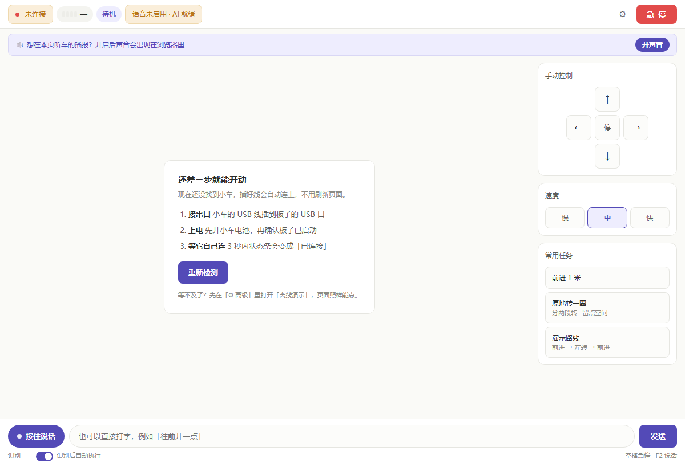

# 远程 Web 控制台

> **在笔记本电脑的浏览器里直接控制和查看小车**，不用再挤在车上那块小屏幕上操作。
> 板子端**无界面**运行（不需要显示器/键鼠），笔记本全权控制。
>
> 前置阅读：《[GUI 语音交互面板](../4.语音模块/GUI语音交互面板.md)》《[多步指令规划器](../4.语音模块/多步指令规划器.md)》

---

## 一、它解决什么

原来的 PySide6 界面跑在**车上**：屏幕小、要接键鼠、现场很别扭。
本方案把控制面搬到笔记本：

```
笔记本浏览器  ──HTTP──►  板子 :8090（car_web.py）  ──串口──►  底盘
                              └─ 复用「网络音箱」:8099 → 浏览器还能当车的喇叭
```

**核心设计：Web 服务必须与 `CarController` 同进程** —— 串口是独占资源，
另起进程会抢串口。所以 `car_web.py` 自己把控制器跑起来，再挂一个 HTTP 服务。



---

## 二、快速开始

**板子上**（不需要显示器）：

```bash
cd ~/car_gui
bash run_web.sh                      # 默认 8090 端口，自动连串口
```

**笔记本上**：浏览器打开

```
http://<板子IP>:8090/
```

启动参数：

| 参数 | 说明 |
|---|---|
| `--port 8090` | 控制台端口（默认 8090） |
| `--serial /dev/ttyCAR` | 指定串口（默认自动找；**没插就静默等待，插上自动连**） |
| `--no-voice` | 不开语音急停（不占用板子麦克风） |
| `--asr` | 额外加载语音识别 → 支持「小车车」唤醒（慢、吃内存） |
| `--no-tts` | 不加载语音合成 |
| `--demo` | 离线演示：照常应答但**绝不发串口** |
| `--llm-mode auto/api/server/cli/off` | LLM 后端 |

> 与 `run_gui.sh` 一样靠 `_pyenv.sh` 解析"哪个 python3"，所以
> **必须用 `bash run_web.sh`** 启动，不要直接 `python3 car_web.py`。

---

---

## 三之二、电脑端一键连接（不用再登板子）

电脑上双击：

```
6.说明文档/2.环境配置/工具脚本/启动小车控制台.cmd
```

它会自动：**找板子**（缓存 → mDNS `davinci-mini.local` → 已知 IP → 可选扫网段）
→ **SSH 上去把控制台跑起来**（已在跑就不重复起）
→ 等 8090 真的能应答 → **打开浏览器**。

| 参数 | 说明 |
|---|---|
| `-Stop` | 停止板子上的控制台 |
| `-Sweep` | 候选都失败时扫本机所在 /24 |
| `-IP 192.168.x.x` | 手动指定板子 IP |
| `-Asr` | 启动时预加载语音识别 |

> 为什么必须 SSH 去启动：串口是独占资源，Web 服务要和 `CarController` **同进程**，
> 所以只能在板子上拉起来 —— 这个脚本把这一步自动化了。
> 用到的是**免密 SSH**（`BatchMode`）；没配免密会提示先 `ssh-copy-id`。

## 三之三、远程语音输入（拿无线麦直接测）

**在电脑界面上按下按钮，板子的麦克风就开录** —— 不用碰板子。

| 方式 | 用法 |
|---|---|
| **按住说话** | 按住「按住说话」（或按住键盘 **F2**）→ 松开自动识别 |
| **自动聆听** | 点一下开；之后直接说话，停顿自动断句识别，一句接一句 |

- **识别结果**显示在界面上；旁边 **电平条**用来确认"无线麦到底有没有在工作"
  （没声音时是 `▁▁▁▁▁▁▁▁`）
- **识别后自动执行**默认**开**（界面上可关）；关掉后可先看文字，再点「执行」
- 语音识别模型**按需加载**：第一次用显示「加载中…（10~30 秒）」，之后一直就绪；
  想开机就预加载，用 `-Asr` 启动

> 麦克风在**板子**上（无线麦接收器插在板子 USB 口），所以这一路是
> 板子录音 + 板子识别，电脑只负责"按按钮"和"看结果"。
> 以后若把识别挪到电脑上，直接 POST `/api/text` 即可（见 §五）。

## 三之四、🔴 两个必须知道的环境坑（自启脚本已自动修）

### 坑 ①：`HwHiAiUser` 不在 `audio` 组 → 麦克风完全看不见

```bash
# 现象：语音输入报「检测不到任何录音设备」，但 cat /proc/asound/cards 明明有声卡
ls -l /dev/snd/pcmC0D0c        # → crw-rw----+ root audio
id HwHiAiUser                  # → 组里没有 audio！
```

**为什么以前能用**：桌面以 `HwHiAiUser` 登录时，logind 会**临时**给该用户发 ACL。
一旦板子停在**登录界面**（没人登录），ACL 只发给 `sddm`，于是我们一个设备都看不到。

**修法**（持久，不依赖桌面会话）：

```bash
usermod -aG audio HwHiAiUser      # 装自启脚本时会自动做
```

### 坑 ②：登录界面的 PulseAudio 独占声卡

`pulseaudio` 以 **`sddm`** 身份运行（登录界面会话），会 hold 住 `/dev/snd/controlC0`，
我们进程用 ALSA 直连就打不开麦克风。

**修法**：服务启动前释放它（systemd 单元的 `ExecStartPre`，自启脚本自动带上）：

```ini
ExecStartPre=-/usr/bin/pkill -u sddm pulseaudio
```

## 三之四之二、🔴 麦克风"被抢"的两个现象（2026-10-28 修复）

### 现象 A：自动聆听一开就刷「麦克风被占用…稍后自动重试」

```
🎤 开始自动聆听（停顿后自动识别…）
🎤 聆听：麦克风被占用（多半是语音急停正在监听），稍后自动重试   ← 无限刷
🎤 聆听：没听到声音（已等 8 秒）
```

**根因（不是"急停真的在监听"）**：自动聆听只把 KWS **让位一次**，但它是
"反复开关麦克风"的循环 —— 中间只要播报一次，播报结束的 `_restore_mic()`
就会把 KWS 拉起来，把麦克风抢回去，下一句就录不进。

**修法**：核心加了**显式的麦克风长期占用者**：

```python
ctrl.claim_mic("自动聆听")     # 开始：让 KWS 让位并"钉住"麦克风
ctrl.release_mic("自动聆听")   # 结束：还回去（KWS 自动恢复监听）
```

- `_restore_mic()` 在有人占用期间**不再恢复 KWS**（只记一行日志）
- `_yield_mic()` 遇到别人占用会**明确报原因**（"麦克风正被「按住说话」占用"），
  而不是静默失败
- `_mic_busy` 的陈旧标记现在会**自愈**（上次异常没清干净时不用重启服务）
- `/api/status` 新增 `mic_owner`，界面在「高级」区把语音急停显示成
  **「已让位（自动聆听用麦克风）」** —— 这才是"急停按钮显示关闭但没坏"的真相

### 现象 B：第一次点「自动聆听」只回一句"正在加载，请稍候再试"

语音识别是**懒加载**（228 MB，10~30 秒）。旧逻辑点一下就返回失败，得点第二次。

**修法**：界面在启动聆听前先 `await /api/voice/load`（和「按住说话」一致），
等模型就绪再开始听。按住说话（PTT）本来就是这么做的。

> 顺带纠正一处**错误文案**：早先界面/日志写着「板子没有喇叭」，但这台板子
> 插了 USB 音箱是**有**外放的。现在统一改成中性说法
> 「想在本页听车的播报？开启后声音会出现在浏览器里」——
> 浏览器播放是**可选**的，不再是"必须"。

---
## 三之五、开机自动启动（板子一上电就能用）

```bash
# 板子上（只需一次）
bash setup_web_autostart.sh              # 安装 + 立即启动
bash setup_web_autostart.sh --status     # 看状态
bash setup_web_autostart.sh --uninstall  # 卸载
```

- 装好后**板子一开机 `car_web.py` 就在跑**，电脑上双击 `.cmd` 直接连上
- 安装时**顺手修上面两个环境坑**（audio 组 + 释放声卡）
- 串口没插好**不会导致服务退出** —— `car_web.py` 内部自动重连，插上就用

---

## 三、界面里有什么（**刻意做减法**）

一屏放下，不需要滚动：

| 区域 | 内容 |
|---|---|
| 状态条 | 连接 / 电压 / 动作 / 急停状态（计划执行中会多一个标记） |
| 方向盘 | **前进 · 后退 · 左转 · 右转** —— 按住走、松开停（键盘 W A S D / 方向键） |
| 速度 | 滑块 + ±，**显示真实 mm/s**（不是固件命令值） |
| 急停 | **整宽大红色按钮，永远可见**（键盘**空格**） |
| 指令 | 文本框 + 发送 + 5 个快捷指令 |
| 🎤 **语音输入** | 按住说话（**F2**）/ 自动聆听 / 识别结果 / 执行 / 自动执行开关 / **电平条** |
| ⚙ 高级 | 默认**收起**：浏览器当喇叭 / 语音急停 / 语音唤醒 / 离线演示 / 日志 |

**键盘**（笔记本上用更顺手）：`W A S D` 或方向键 = 方向，`空格` = 急停，`回车` = 发送指令。
**手机/平板**也能开（自适应，`pointer` 事件）。

### 被删掉的东西（相对原 GUI）

| 删掉/收起的 | 为什么 |
|---|---|
| **左移 / 右移** | 本车实测**不支持平移**（已在 API 白名单里也拒绝 `strafe_*`） |
| 设备列表下拉、模型目录输入框、"加载模型" | 调试用，现场不需要（要调试去板子上敲命令） |
| 连接 / 断开按钮 | 改为**自动连接**，状态条显示连接状态 |
| 刷新设备列表、刷新麦克风、清空日志 | 冗余 |
| 勾选框：播报 / 动作播报 / 纯聊天 / 识别后自动执行 / 锁定持续运动 | 用合理默认值代替 |
| 离线演示 / 语音急停 / 语音唤醒 | **收进「高级」**（默认收起，不占主界面） |

---

## 四、🔴 安全设计（**改代码前必读**）

### 4.1 心跳看门狗：断网/关页面自动停车

方向键是"按住走、松开停"：按下发 `duration=None`（持续运动），松开才发停车。
**如果笔记本断网、关页面、休眠，停车命令就到不了** —— 车会一直开。

所以：

```
网页每 1 秒发一次 /api/status（顺带续期心跳）
看门狗每 0.4 秒检查：若"网页发起的持续运动"超过 3 秒没心跳 → 立刻停车
```

⚠️ **看门狗只兜底"网页发起的持续运动"**，**不去动**：
- 定时运动（`move(..., duration)` 自带 Timer 停车）
- 多步计划（`_run_plan` 逐步定时，且能被急停打断）

否则会误杀用户正常发起的指令（这一点有回归断言锁死）。

另外：`pagehide` 与 `visibilitychange` 时用 `sendBeacon('/api/stop')` 立刻停车。

### 4.2 急停永远第一优先

`/api/estop` 是 POST 分支里的**第一条**，不排队、不判断其他状态，
直接走 `trigger_emergency()`（停车 → 锁定 → 播报）。
锁定后所有运动请求被拒（`/api/action` 再挡一次）。

### 4.3 键盘不劫持输入框

⚠️ 曾经有个隐患：键盘监听没排除输入框 —— **在指令框里打字时按 W/A/S/D 会把车开走**。
现在 `keydown` 先判断 `e.target.tagName`，输入框/滑块里一律不控车（有回归断言）。

### 4.4 动作白名单

网页只能下发 `forward / backward / turn_left / turn_right / stop`
（**故意不含 `strafe_left/right`**）。乱编的动作被拒。

---

## 五、HTTP API（也给你自己写脚本/后续电脑端语音用）

| 方法 | 路径 | 说明 |
|---|---|---|
| GET | `/` | 控制台网页 |
| GET | `/api/status` | 状态快照（含 `speed_mmps` 真实速度、`plan_running`、`holding`） |
| GET | `/api/logs?since=N` | 增量日志 |
| POST | `/api/action` | `{"action":"forward"}`（无 duration=持续）/ `{"action":"forward","duration":1.5}` |
| POST | `/api/stop` | 停车（并清 `holding`） |
| POST | `/api/estop` | **急停 + 锁定** |
| POST | `/api/estop/release` | 解除锁定 |
| POST | `/api/speed` | `{"value":30}` |
| POST | `/api/text` | **`{"text":"先前进半米，再左转30度"}`** ← 文本指令入口 |
| POST | `/api/heartbeat` | 续期心跳 |
| POST | `/api/demo` | `{"on":true}` 离线演示 |
| POST | `/api/voice/estop` · `/api/voice/wake` | `{"on":true}` 语音开关 |
| GET | `/api/tts/seq` · `/api/tts/next` · `/api/tts/audio/N.wav` | 浏览器当喇叭（长轮询） |
| POST | `/api/power` | **远程重启/关机**：`{"action":"reboot"｜"shutdown","confirm":"yes"}`（见 §十） |
| GET | `/api/mic` | **输入麦克风列表**：`{devices:[{index,name,label,channels,samplerate,preferred}], current, auto}` |
| POST | `/api/mic` | **切换输入麦克风**：`{"index":2}` 或 `{"auto":true}`（见 §十一） |

> **`/api/text` 是给"电脑端语音识别"预留的入口。**
> 以后在电脑上把语音转成文本（更准更快、还能绕开板子"麦克风/播放互斥"的痛点），
> 直接 POST 过来即可，**板子这边一行都不用改**：
> ```bash
> curl -X POST http://<板子IP>:8090/api/text \
>      -H 'Content-Type: application/json' \
>      -d '{"text":"前进一米"}'
> ```

---

## 六、实现要点（改代码前看）

| 文件 | 说明 |
|---|---|
| `car_gui/car_web.py` | 服务端：纯 **stdlib**（`ThreadingHTTPServer`），**不需要 Flask** |
| `car_gui/web_ui.html` | 单页界面：内联 CSS/JS，**无外部依赖**（离线局域网也能用） |
| `car_gui/run_web.sh` | 启动脚本（复用 `_pyenv.sh` 选解释器） |
| `car_gui/test_web_console.py` | 离线回归（假车注入，164 项断言） |

**后台线程**：日志泵（0.25s）· 看门狗（0.4s）· 文本串行执行队列 · 串口自动重连。

**为什么 `/api/text` 要排队异步执行**：LLM 纠错要 3~10 秒，
同步做 HTTP 早超时了。所以立刻返回"已提交"，实际执行放工作线程，
结果通过 `/api/logs` 和状态体现。

**为什么网络音箱复用同一份广播对象**：`init_tts` 会把合成结果 push 到
`tts_serve` 的 `Speaker`，控制台用同源端点（`/api/tts/*`）转发，
**避免 8090↔8099 跨域**。

---

## 七、回归测试

```bash
cd ~/car_gui
bash run_py.sh test_web_console.py       # 164 项断言，不需要串口/音频/显示器
```

已锁死的关键行为：

- ✅ 首页含急停、**不含左移/右移**、不含已删除元素
- ✅ **心跳看门狗**超时自动停车；**定时运动不被误杀**
- ✅ 白名单拒绝 `strafe_left`/乱编动作；锁定后动作被拒
- ✅ **中文文本 UTF-8 不被破坏**；单步与多步都真的分帧下发
- ✅ 速度钳位（上界 500 / 下界 25）；非法值被拒
- ✅ 无 TTS 时端点优雅降级；未知路径 404
- ✅ 输入麦克风：列表/切换/恢复自动/非法 index 被拒（2026-11-05）
- ✅ **浏览器当喇叭：开启先锚定序号、不重放历史播报、同一条不重复返回**（2026-11-03）

同时已登记进总回归 `test_all_offline.py`（"Web 控制台"一项）。

---

## 八、已知限制

1. **速度滑块上限设成 60**（核心允许到 500）。原因：实测命令值 **>34 已接近本车最高速**
   （模型饱和），拖到右边并不会更快 —— 给 25~500 反而误导。要做"走廊安全模式"
   请见《[功能模块进度总览](../1.总览与架构/功能模块进度总览.md)》任务 C3。
2. **浏览器语音未做**（按需求）。板子麦克风仍可开语音急停（`高级 → 语音急停`）。
   电脑端语音识别走 `/api/text`，见 §五。
3. **无访问口令**（按需求"暂时不要"）。**同网段任何人都能开**，
   演示场合注意；要加就加一个 token 校验。
4. **多步计划进度只显示"执行中"**，没有第 k/n 步（核心暂未暴露步号）。
5. 网页的"当喇叭"需要**点一下开关**（浏览器自动播放策略要求用户手势）。
6. **服务重启偶尔会留下占端口的旧进程**（2026-11-05 踩到两次）：`systemctl restart`
   后 `is-active` 显示 activating / 失败，但 8090 还能访问 —— 旧 `car_web.py`
   没被杀掉，新进程绑不上端口。处理：
   ```bash
   sudo systemctl stop car-web
   sudo fuser -k 8090/tcp 8099/tcp
   sudo systemctl start car-web
   ```

---

## 九、故障修复记录

### 2026-11-03：浏览器当喇叭关不掉 / 一直复读「系统就绪」

**现象**：高级设置里把「🔊 浏览器当车的喇叭」开了再关，浏览器仍会出声；
反复开关几次后，听起来像一直在念「系统就绪」，像卡带。

**三个根因（都在 `web_ui.html` 的前端，服务端接口没问题）**：

1. **开启时从序号 0 开始取音**：`/api/tts/next?since=0` 会返回服务端保留的
   历史播报（开机播报「系统就绪」、之前的指令播报……），所以一开声音就把
   旧话从头重放一遍。
2. **关闭只改了标志位**：`/api/tts/next` 是长轮询（最长阻塞 20 s）。已经挂起
   的请求返回后仍会 `play()` —— 关了开关还会再冒出一句；正在播的那句也不会停。
3. **重复点开关会叠加轮询循环**：旧实现每次「开启」都启动一个
   `listenTts()`，关闭时不取消。N 次开关 = N 个循环抢同一个 `Audio` 元素，
   同一句被反复 `play()`，互相打断 → 听感就是"复读同一句"。

**修复（只改 `car_gui/web_ui.html`，不动服务端安全逻辑）**：

- **开启先锚定**：先 `GET /api/tts/seq` 拿当前序号，只取**之后**的新播报；
- **关闭真停**：`AbortController.abort()` 中断长轮询 + `audio.pause()` +
  清空 `src`；正在播的立即静音；
- **单循环**：世代号 `ttsLoopId` 保证同一时间只有一个轮询循环；
- **一次一条**：等 `ended` 再取下一条，避免多条播报叠在一起互相打断。

**回归与实测**：

- `test_web_console.py` 新增 [7b] 组（锚定序号、不重放历史、同一条不重复返回、
  音频端点可下载）+ 3 条页面静态契约；**132 项全过**（后续加到 146 项）。
- 真机（2026-11-03 21:36，板子 `192.168.31.128`，离线演示模式）：
  ```
  锚定 seq=1 → 发「前进一米」→ /api/tts/next?since=1
  返回 {"seq":2, "text":"开始前进"}      ← 只给新播报
  再取 since=2 → 空                       ← 不重复
  对照 since=0 → {"seq":1,"text":"系统就绪"}  ← 旧 bug 路径，已不再被前端使用
  ```

> **注意**：`web_ui.html` 在服务启动时被读进
> `State.ui`，**改完 HTML 必须重启服务**（`sudo systemctl restart car-web`）
> 才会生效；只刷新浏览器看不到新页面。

---

## 十、远程电源（高级功能：重启 / 关机）

> 位置：**高级设置 → 🔌 开发板电源 → [重启] [关机]**。
> 主界面刻意不放（避免误触）；按钮默认 **hidden**，
> 只有板子装好提权助手（`/api/status` 的 `power=true`）且页面收到状态后才出现。

### 10.1 一次性安装（板子上，root）

`car-web.service` 以 `HwHiAiUser` 运行，普通用户没有关机权限。这里**不**把整个
`systemctl` 暴露给服务账号，而是装一个只认 `reboot / shutdown / check` 的小脚本，
sudoers 只放行它：

```bash
cd /home/HwHiAiUser/car_gui
sudo bash setup_power.sh

# 验证（不会真重启）
su -s /bin/sh HwHiAiUser -c 'sudo -n /usr/local/sbin/car-power check'   # → ok

# 让新代码生效
sudo systemctl restart car-web
```

装好后：`/usr/local/sbin/car-power`（root:root 755）+ `/etc/sudoers.d/car-power`（440）。
撤销：删掉这两个文件即可，服务会退回「电源按钮隐藏」。

### 10.2 执行链路（安全顺序）

```
点「重启 / 关机」→ 弹窗二次确认 → POST /api/power
  → 服务端校验 action 白名单 + confirm 字段
  → ctrl.stop()                       ← 先停车，不能带着运动指令掉电
  → 1.5 s 后 sudo -n car-power reboot|shutdown
  → 浏览器先收到"已提交"回包，然后断开
```

- 延迟 1.5 s 是为了**先回包**：否则页面只会看到"请求失败"。
- 关机后需要重新上电；重启约 30~60 秒后 `car-web` 会随开机自启恢复
  （刷新页面即可，或双击桌面「启动小车控制台」）。

### 10.3 安全边界（重要）

- **动作白名单**：服务端只认 `reboot` / `shutdown`，其它动作 400。
- **必须带 `confirm`**：缺字段直接拒绝 —— 防误触，也防随手 `curl`。
- **最小提权**：sudoers 只允许 `car-power`，且参数固定为三个动作之一；
  服务账号拿不到通用 root 权限（也拿不到 `systemctl` 的其它子命令）。
- ⚠️ **没有访问口令**（沿用全站现状）：同网段的人能打开网页，也就能点关机。
  答辩/公共网络场景建议先停服务或加 token —— 这是刻意记录的已知限制。

### 10.4 测试

`test_web_console.py` [15] 组锁死：未装助手时拒绝、缺 `confirm` 拒绝、
非白名单动作拒绝、**掉电前先发停车帧**、1.5 s 后执行、默认走
`sudo -n /usr/local/sbin/car-power`。

---

## 十一、输入麦克风选择（阵列麦 / 无线麦）

> 位置：**高级设置 → 🎙️ 输入麦克风**（下拉框 + 刷新）。
> 主界面不放；打开高级抽屉时才枚举设备（不占每秒轮询）。

### 11.1 用法

1. 板子上插好麦克风 → 打开「高级设置」，下拉框会自动列出**真实录音硬件**
   （ALSA 的 `sysdefault/pulse/default` 这类软件插件会被过滤掉）；
2. 选一个 → 立即记住（落盘到 `~/.config/car_gui/mic_device.txt`，权限 0600），
   下一次「按住说话 / 自动聆听」就用它；
3. 选「自动选择（按能力打分）」= 忘掉偏好，回到 `guess_input_device()` 的自动打分。

**本板实测枚举**（2026-11-05；三只都正常枚举时）：

| index | 设备名 | 通道/采样率 | 说明 |
|---|---|---|---|
| 0 | `USB2.0 Device: Audio (hw:0,0)` | 1ch / 48 kHz | 原默认麦克风 |
| 1 | `USB Audio: - (hw:1,0)` | 2ch / 44.1 kHz | SPACETOUCH 无线麦接收器（带播放） |
| 2 | `DOV: USB Audio (hw:2,0)` | 2ch / 44.1 kHz | **阵列麦 HK-QXMIC-V3.0**（界面显示「阵列麦 · QXMIC」） |

> ⚠️ **index 不是固定的**：换 USB 口、插拔、哪个进程先枚举，都会让索引变化。
> 偏好保存的是**设备身份**（`device_identity`，如 `dov: usb audio`），不是 index ——
> 重插后即使从 `[2]` 变成 `[1]`，仍然会选中同一只麦（下拉里会显示新的 index）。
>
> 如果无线麦没出现在下拉里，多半是板上没枚举出来：重插接收器 → 点「刷新」。

### 11.2 生效范围（重要）

- **立即生效（车停稳时）**：`按住说话`（PTT）每次录音都重新 `guess_input_device()`；
  `自动聆听` 若正在跑，切换后会在后台**自动停掉再用新设备重开**（约 1 秒）。
- **语音急停/唤醒（KWS）会自动跟随**（2026-11-05 起）：切换后自动
  「停旧监听器 → 用新设备重建 → 恢复自动聆听状态」。
  ⚠️ 重建期间 **约 8~10 秒语音急停不可用**（日志会先打
  `⚠ 语音急停正在切换麦克风（约 8~10 秒不可用）…`）。
- **车在运动/计划执行中不立即切 KWS**：只保存偏好并挂起，等心跳看门狗发现
  「车停稳、无计划在跑」后自动重启（日志：`小车已停稳 → 开始按新麦克风重启语音急停`）。
  这样不会出现"车还在跑、语音急停却空了 10 秒"。
- 若 KWS 重启失败（新设备被别的进程占着等），日志会写
  `语音急停已按新麦克风重启：失败`；此时设备选择已保存，可重启服务兜底。

### 11.3 API

```bash
# 列表（含当前偏好 / 自动选择结果）
curl --noproxy '*' http://<板子IP>:8090/api/mic

# 选阵列麦（index 以列表为准）
curl --noproxy '*' -X POST http://<板子IP>:8090/api/mic \
     -H 'Content-Type: application/json' -d '{"index":2}'

# 恢复自动选择
curl --noproxy '*' -X POST http://<板子IP>:8090/api/mic \
     -H 'Content-Type: application/json' -d '{"auto":true}'
```

### 11.4 测试

`test_web_console.py` [16] 组锁死：列表（含友好名）、非法 index 被拒、
切换后 `preferred/current` 同步更新、恢复自动选择、缺参数被拒；
以及 **KWS 跟随**：车停稳时按 `disable → enable` 顺序重建、
运动中只挂起、停稳后由看门狗自动重启。
