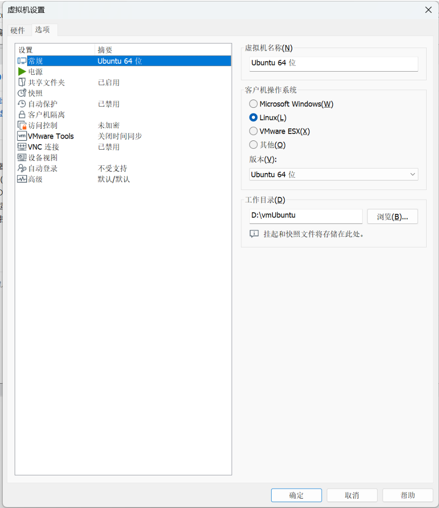

# 5\.NFS共享文件系统配置

在我频繁使用windowsPC，X86虚拟机Ubuntu和开发板arm64的Linux系统的过程中，我发现文件传输极其麻烦，当我需要调试一个c语言程序的时候，需要将开发板系统生成的core文件多次拷贝到虚拟机系统中进行调试。另外，当需要下载一些模型文件的时候，开发板的网速往往不够，下载速度缓慢。

在询问AI后，我得到了可以使用VMware共享文件夹和NFS共享文件目录的方法，让这三个不同环境的设备都能同时访问这个文件夹，从而实现高效的文件交换。


### 打通三设备网络

为了让虚拟机，物理机，开发板的三个系统处于同一个网段，我们需要设置虚拟机网络桥接到wifi网卡上，

#### 检查宿主机网卡设置


在网络中心中，找到当前在使用的网卡，确保VMware Bridge Protocol这个选项是勾选的


#### 虚拟网络编辑器

首先打开虚拟网络编辑器， 在上方工具栏的编辑里面找到虚拟网络编辑器，打开后，点击更改设置后才能镜像后续的修改。


找到一张网卡，或者是新增一张网卡，设置为桥接模式，桥接到自己的上网用的网卡，


在虚拟机设置中，找到网络适配器，将网络连接设置为自定义，然后选择之前我们配置了桥接的那一个虚拟网卡，接下来就可以进入虚拟机中，确认和宿主机是否在同一个网段中。


#### 确认网络联通性

理论上，到了这一步，宿主机，虚拟机，开发板应该都属于同一个网段，可以通过三设备互相ping来验证，如果三设备互相ping都能够成功，说明我们的网络已经完美配置完成。

### 虚拟机\<\-\-\>windowsPC

由于我虚拟机使用的是VMware，这款虚拟机软件提供了方便的windows\-\>Ubuntu系统的共享文件夹设置，具体操作方法可以按照下图的示范来进行。

首先点击软件上方的虚拟机\-\>设置



找到共享文件夹选项，启用后点击添加，按照程序的指示完成配置，


这时，我们就可以在/mnt/hgfs的路径下看到我们的共享文件夹。

这一步完成后，我们可以看到共享文件夹，但是有一个问题是，在虚拟机的系统重启后，我们就看不到这个共享文件夹中的内容，因为在linux系统中，重启可能会导致系统忘记挂载这一个共享文件夹；

我们先临时找回这个文件夹；

打开虚拟机终端，然后输入

```Bash
/mnt/hgfs
```

如果成功输出了在VMware中设置的共享文件夹名字，则说明文件都还在，只是没有挂载出来，可以进行下一步。

接下来，我们通过修改 `/etc/fstab` 配置文件，告诉系统每次开机都要自动挂载这一个文件夹

**操作步骤：**

1. **创建挂载点**（如果 `/mnt/hgfs` 目录不存在）：

```Bash
sudo mkdir -p /mnt/hgfs
  ```
2. **编辑配置文件**：

```bash
sudo nano /etc/fstab
```

在文件的末尾另起一行，输入：

```Plain Text
.host:/ /mnt/hgfs fuse.vmhgfs-fuse allow_other 0 0
```

保存后，直接输入以下命令后，去文件目录中找找能不能看到自己的文件

```Bash
sudo mount -a
```

### 虚拟机\<\-\-\>开发板

由于NFS共享文件系统是为Linux系统准备的，所以我们选择使用虚拟机的系统和开发板的系统共享文件夹，从而做到3设备共享同一文件夹的效果，

#### 在虚拟机上配置NFS服务

首先，我们需要在虚拟机上安装NFS服务，并且告诉它：“我允许开发板访问的共享的文件夹”

1. 安装NFS服务：

在虚拟机的终端中执行以下命令下载NFS服务：

```Bash
sudo apt-get update 
sudo apt-get install nfs-kernel-server
```

2. 配置共享目录：

编辑配置文件：

```Bash
sudo nano /etc/exports
```

然后在文件末尾添加上一行（注意替换为自己实际文件夹的路径）：

```Plain Text
/mnt/hgfs *(rw,sync,no_root_squash,insecure,fsid=0,no_subtree_check)
```

3. 重启NFS服务生效：

    ```Bash
    
    ```

sudo /etc/init\.d/nfs\-kernel\-server restart

```Plain Text


#### 在开发板上挂载
现在服务器已经准备好了，接下来，我们去开发板上将它挂载上。
1. 首先安装NFS工具包：
```bash
sudo apt-get update
sudo apt-get install nfs-common
```

1. 在开发板上创建一个挂载点：

```Bash
mkdir -p /mnt/nfs_share
```

3. 执行挂载命令

假设虚拟机的IP是`192.168.31.20`，我们输入以下命令挂载：

```Bash
sudo mount -t nfs -o nolock 192.168.31.20:/mnt/hgfs/VMshared /mnt/nfs_share
```

3. 验证

我们输入`ls /mnt/nfs_share`来确认是否能看到文件。


如果可以在三地同时看到文件，以及文件的修改内容，则说明已经配置成功；


### 多人同时使用的配置方法;


在虚拟机上，按照上面提到的方法进行部署服务。

然后，可以自己独立创建一个挂载点，

```Bash
# 1. 挂载你的虚拟机 (IP: 192.168.31.185) 
sudo mount -t nfs -o nolock,vers=3 192.168.31.185:/mnt/hgfs /mnt/my_share 
# 2. 挂载队友的虚拟机 (IP: 192.168.31.186) 
sudo mount -t nfs -o nolock,vers=3 192.168.31.186:/mnt/hgfs /mnt/teammate_share
```

按照示例在约定好的路径挂载好自己虚拟机上的共享文件夹即可。

